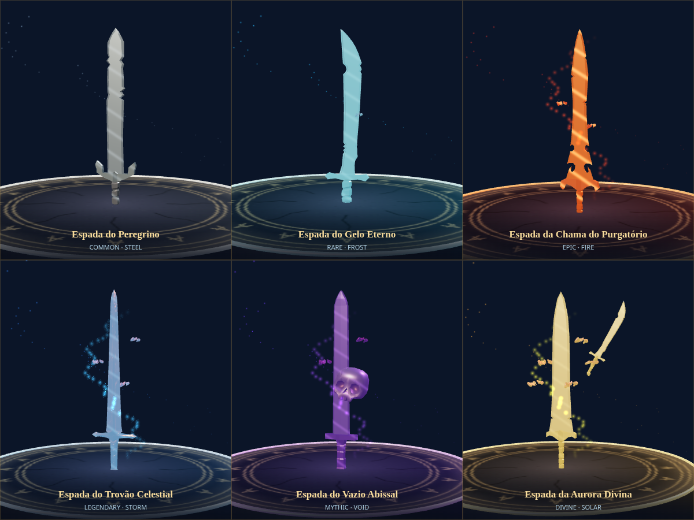
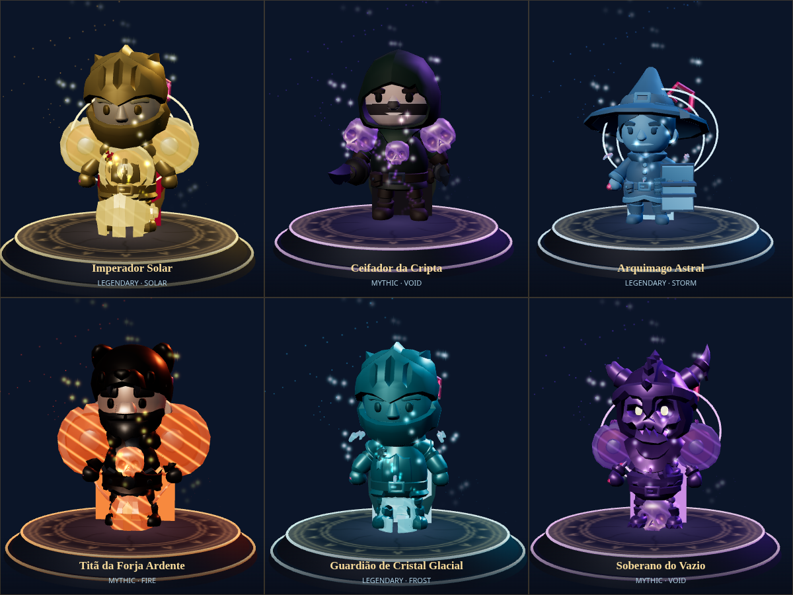
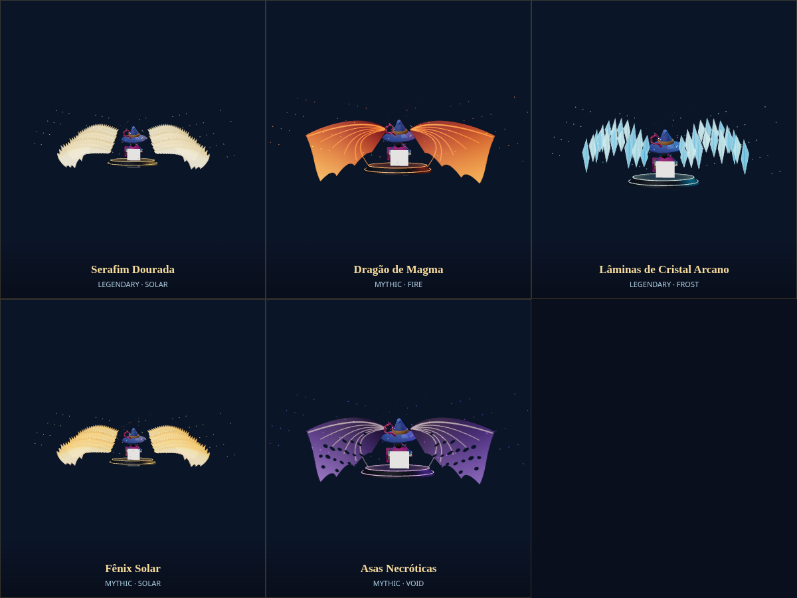
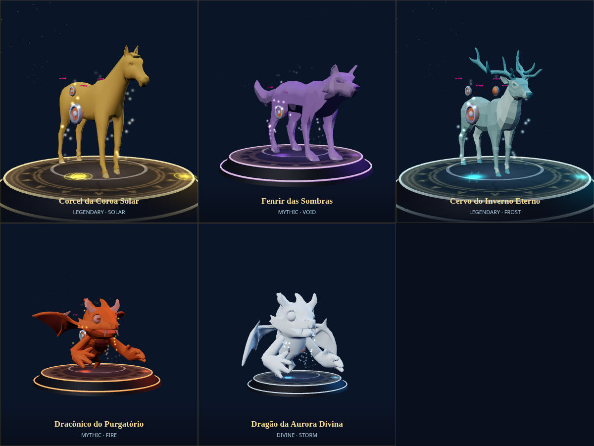
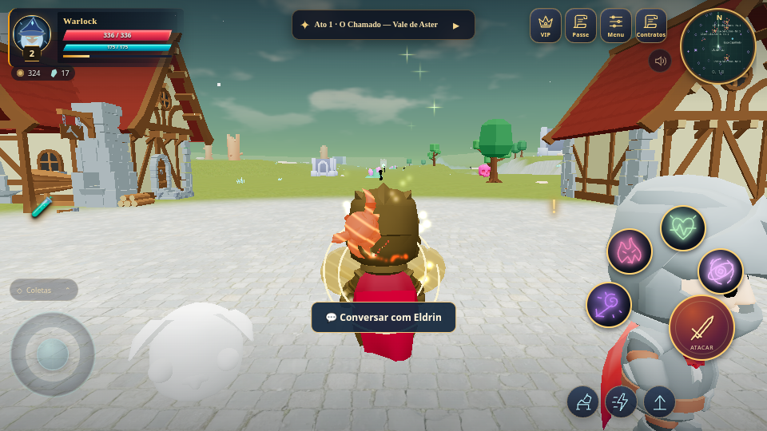
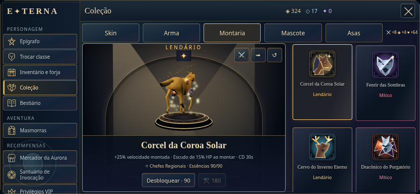

# PR #22 — catálogo de skins, equipamentos e fontes jogáveis

Branch: `feat/pr22-complete-skins-overhaul`. Base: `dc67881`, a `main` após o merge do PR #21. O diff contém somente a reforma do catálogo.

## Catálogo e apresentação

- **54 armas**, seis grades em cada uma das nove classes reais: Comum, Rara, Épica, Lendária, Mítica e Divina. Divina é uma grade cosmética explícita; não adiciona uma sétima raridade de equipamento nem altera as probabilidades existentes do gacha.
- Cajados, cetros, espadas, adagas, arcos, lanças, foices e bastões seguem os sockets da classe. Adagas continuam nas duas mãos; arqueiros mantêm arco/aljava e paladinos mantêm escudo. Os novos IDs têm restrição de classe. IDs genéricos antigos continuam válidos e resolvem para composições da classe atual.
- As composições combinam GLBs CC0, cristais, crânios, lâminas secundárias e materiais próprios. Foram substituídas bases antigas de espada muito simples e adicionados cajados/armas distintos. Gelo usa transparência ciano; fogo tem metal escuro e veios emissivos; trovão combina metal dourado e partículas elétricas; vazio usa metal escuro/roxo e partículas dimensionais. Armas Épicas+ alteram os rastros, projéteis e impactos reais do combate.
- **Seis trajes completos**: Imperador Solar, Ceifador da Cripta, Arquimago Astral, Titã da Forja Ardente, Guardião de Cristal Glacial e Soberano do Vazio. Usam cinco corpos GLB diferentes, acessórios de cabeça/peitoral/ombros, capa simulada, paleta do corpo e energia própria. O corpo visual pode mudar; classe, skills e regras de combate permanecem as escolhidas pelo jogador.
- **Cinco asas** com textura, camadas, envergadura e curvatura próprias: Serafim, Dragão de Magma, Cristal, Fênix e Necróticas. Cada lado é uma malha combinada, com partículas em um único lote.
- **Cinco montarias**: corcel imperial, Fenrir, cervo glacial, dracônico de magma e dragão da aurora. Cervo e dragão antigos que continham somente cabeças foram substituídos por GLBs de corpo completo. Armadura/adornos continuam anexados e o cavaleiro usa a sela calculada do corpo real.
- Pegadas elementais usam um pool de **64 instâncias**, com vida de quatro segundos, uma chamada de desenho e nenhuma criação de malha por passo. Deslocamentos grandes limpam o rastro; desmontar também o limpa.

Os pets e IDs anteriores são preservados. A vitrine principal prioriza o catálogo novo, com classe/grade, fonte, saldo, custo, bônus e ações de desbloqueio. O palco aceita rotação 360° por pointer events, zoom por pinça/roda, teste de ataque/corrida/montaria e restauração de câmera. A prévia e o mundo usam as mesmas implementações visuais.

## Atributos e passivas

Cada aparência conhecida desbloqueada contribui permanentemente no **perfil PvE local**: peso 1/1/2/3/4/5/6 para Comum/Incomum/Rara/Épica/Lendária/Mítica/Divina, somando ATK, 60% desse peso em DEF e oito vezes o peso em HP. Propriedades são derivadas da posse única, não de um contador que possa ser incrementado repetidamente ao equipar.

Passivas dos visuais modernos Lendários+ entram no combate: +18% de dano a elites/chefes, raio celestial com cooldown de quatro segundos, meteoro com cooldown de seis segundos, 4% de roubo de vida, +25% de velocidade montada, escudo de 15% de HP ao montar com cooldown de 30 segundos e +20% de ouro de contratos/chance de equipamento enquanto houver contrato aceito. Efeitos iguais usam o maior valor equipado, sem multiplicadores repetidos. O cooldown dos procs sobrevive à troca de equipamento.

O **PvP continua normalizado pelo servidor**: esses bônus/escudos locais não são enviados como atributos autoritativos. Ao entrar na arena, o escudo local é removido. A obtenção via PvP usa resultados encerrados de partidas ranqueadas com o próprio jogador presente; treino com bots não concede essa essência. Nenhum saldo local é importado para moedas, inventário, Elo ou contas do servidor.

## Fontes de obtenção

O catálogo mostra fontes primárias e permite forjar qualquer entrada com Fragmentos do Catálogo, sem VIP obrigatório:

| Fonte | Crédito por conclusão/coleta |
| --- | ---: |
| Elite | 8 essências |
| Fenda completa | 16 essências |
| Contrato S/SS resgatado | 14 essências |
| Baú de Massacre destruído e coletado | 12 essências |
| Chefe regional do mundo aberto | 18 essências |
| Torre da Eternidade completa | 22 essências |
| Partida PvP ranqueada encerrada | 10 essências |

Fontes também geram 25% desse crédito, arredondado para cima, em Fragmentos do Catálogo universais. Acampamentos/baús comuns podem fornecer fragmentos universais. Custos por grade: 16/30/55/90/150/250 essências; a rota universal custa o dobro. A aquisição gacha existente permanece disponível conforme seus pools.

Créditos de campo chegam **no pickup real**, não ao abrir uma janela. Fendas e massacres que geram vários drops creditam a essência da atividade somente no primeiro drop. Resgates, tokens e desbloqueios são idempotentes e persistem no save. As essências/Fragmentos do Catálogo são separados dos fragmentos de baú do PR #21 e das carteiras online.

A Torre da Eternidade agora é uma instância selecionável de nível 35 nas Ruínas de Cristal Gelado, acessada pela entrada física de masmorra da região. Tem planta própria, três andares, três salas de progressão/selos e o Oráculo da Aurora; o crédito ocorre ao concluir os três andares. As quatro masmorras anteriores e a seleção padrão permanecem.

## Assets, correções e limites

São **19 GLBs CC0 novos**, somando **1.683.232 bytes** após otimização offline. O manifesto em `public/models/pr22/manifest.json` registra URLs fixadas no commit de origem, licença, hashes de origem/saída e tamanhos. `scripts/import-pr22-skins.mjs` reproduz download, simplificação conservadora, Meshopt e texturas WebP de até 512 px usando as dependências já presentes. Geometrias/texturas carregadas são compartilhadas; materiais e acessórios equipados têm descarte próprio. Não se carrega todo o catálogo para mostrar um item.

Além das mudanças visuais, foram corrigidos: coleta que retirava o drop antes do consumidor validar sua existência; conversão segura de materiais GLB unlit para PBR; literais negativos que produziam `position.y--1.0` em GLSL; e callback atrasado de montaria que podia reaplicar uma aparência anterior após troca rápida.

Nenhum APK foi compilado ou modificado e não há mudanças em Android. A arquitetura TypeScript/Three.js/Vite/Capacitor permanece.

## Validação e capturas

- `npm test`: **372 testes em 47 arquivos**, incluindo 27 casos novos para catálogo, fontes/custos, persistência, bônus únicos, passivas, dano real, cor do rastro, escudo, geometria de asas e pool de pegadas. Expectativas antigas de quatro masmorras e camadas de asa fixas foram atualizadas para a Torre e as silhuetas variáveis.
- `npm run build`: TypeScript/Vite aprovados. Permanece o aviso de tamanho do bundle principal.
- `python3 scripts/render-pr22.py`: 22 aparências renderizadas lado a lado — seis armas, seis trajes, cinco asas e cinco montarias — com GLBs, materiais e shaders de produção. Nenhum erro de shader, página ou recurso. Relatório: `render-report.json`.
- `python3 scripts/smoke-pr22.py`: Chromium mobile verifica pickup real pelo sistema de pet/herói, crédito único, desbloqueio, equipamento, salvamento, bônus imediato, rotação por ponteiro e testes de animação. O palco tem 169,8 px de altura útil em 844×390; não corta o modelo. Renderiza também o traje e a arma equipados no mundo aberto. Relatório: `browser-report.json`.

Os scripts requerem Playwright Python, Chromium em `/usr/bin/chromium` e `npm run dev` em outra sessão. `ETERNA_URL` permite outra URL local. O teste funcional injeta mortes e recursos somente no desenvolvimento local e controla manualmente os frames. Capturas gráficas usam SwiftShader, resolução limitada e sombras desativadas no fixture. **Não são benchmark de FPS Android.**

