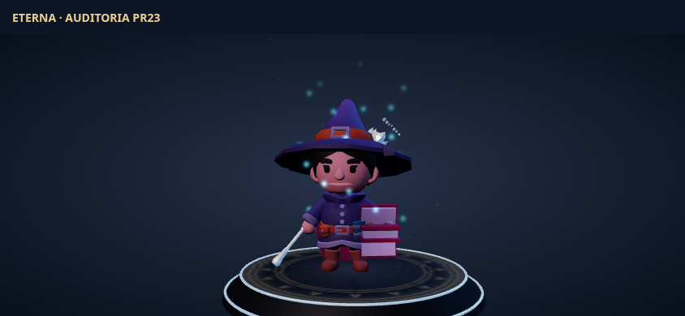
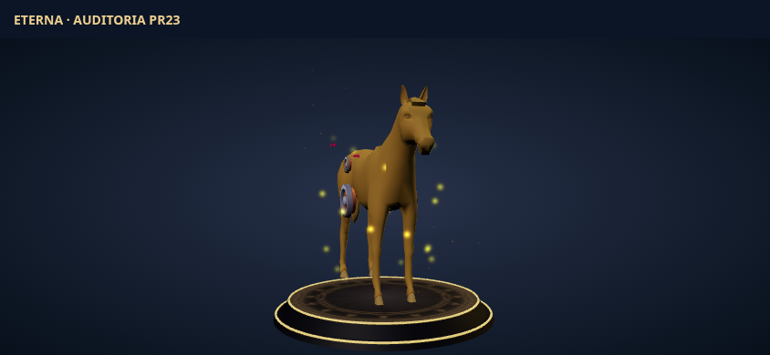
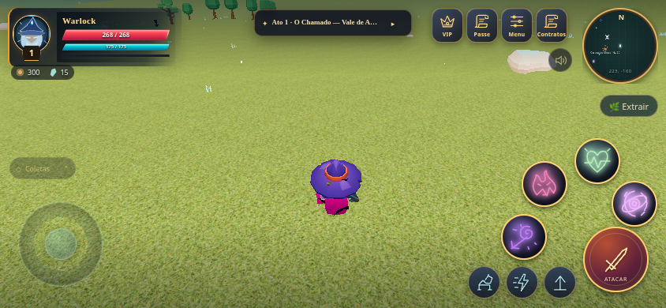
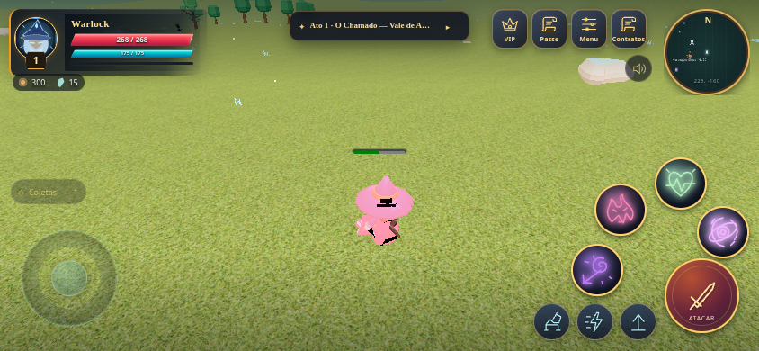
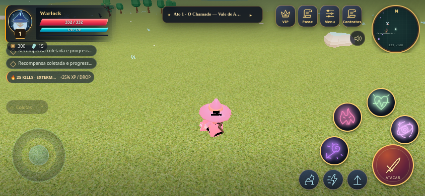

# PR #23 — auditoria de skins, montarias, armas e coleta

Base: `fd58ffb`, `main` com o PR #22 mesclado. Branch: `feat/pr23-engine-audit-lag-fix`.

## Problemas encontrados e correções

**Referências e memória.** A lista de acessórios do ator mantinha objetos que já haviam sido retirados do osso. A capa podia ser removida novamente pelo descarte do ator anterior depois de voltar ao torso, ficando fora da árvore percorrida para liberar geometrias. O teste WebGL inicial encontrou cinco geometrias adicionais após 50 trocas. Agora há remoção explícita das referências de attachments, descarte garantido da capa e liberação da textura GPU do esqueleto ao devolver o clone ao pool. Seleções assíncronas antigas e preparações de arma que falham também liberam seus recursos.

`AppearanceResources` compartilha materiais imutáveis por origem/estilo usando leases com contagem de referências. Flash de dano, paleta e uniforms mutáveis de corpos continuam particulares de cada ator. Geometrias e texturas de GLTF são compartilhadas enquanto houver clones ativos; quando o último uso termina, seus buffers GPU são liberados. Os dados CPU permanecem no cache para reutilização sem novo download. Não se destrói o dado geométrico usado por outro clone ativo.

**Prévia.** Inventário e Coleção reutilizam o mesmo `CharacterPreview`, renderer e canvas. Um fingerprint da aparência impede reconstruir armas quando o menu apenas é repintado. Há um único RAF pendente; fechar a prévia cancela o loop, desconecta a observação de tamanho, limpa gestos e descarta o ator. O palco e o renderer ficam disponíveis para reabrir; o descarte definitivo também limpa render lists e encerra o contexto. A iluminação do palco usa luzes direcionais fixas, sem PointLight/SpotLight. Nenhuma luz dinâmica fica anexada a skins, armas, asas ou montarias.

**Partículas.** A aura do personagem é um único `Points` de **32 partículas**, movidas por GLSL. As asas não criam outro emissor; o brilho vem de seus materiais e do emissor compartilhado do herói. Halos permanecem efeitos geométricos limitados; efeitos de arma equipados não adicionam outro conjunto de partículas. Montarias/pets também usam um emissor limitado. O fundo da vitrine caiu de 80 para 16 partículas, separado do personagem. As superfícies das asas usam alpha test com depth write, sem transparência de toda a malha.

**Montarias.** Todo o corpo procedural e o batching de fallback foram removidos de `CompanionRig`, inclusive no caminho headless. O Corcel de Guerra Base mantém o ID antigo `horse` e usa o cavalo orgânico animado já licenciado. Todas as entradas de montaria resolvem para GLBs com skeleton e clips reais de repouso/locomoção; o slot de dragão que apontava para um corpo estático passa a compartilhar o rig animado do wyvern, preservando seu ID, cor e adornos. Não foi inventado um galope procedural para essa malha estática.

Montar aguarda o GLB ficar pronto. Trocar de montaria durante a cavalgada devolve primeiro o herói ao seu pai original, aguarda a nova criatura e refaz a ligação na sela. A sela está identificada como `MountSocket` e conserva o nome legado `mountSaddleNode`. Posição dorsal, escala do cavaleiro, velocidade física e efeitos mantêm a integração existente. Desmontar, morrer ou entrar na água não deixa o herói preso a um modelo removido.

**Armas.** `WeaponSkinSystem` mantém um `WeaponHandSocket` na mão direita, o equivalente `.Left` na mão esquerda e sockets de acessórios separados. Antes de instalar uma nova arma, o conteúdo antigo é limpo. Um token de geração impede que um download atrasado recoloque a skin anterior. A origem da empunhadura fica em `(0,0,0)`, com orientação pelo eixo longo e perfis de tamanho/posição para adaga, arco, lança, cajado e espada. O socket normaliza a escala do osso. Uma skin possuída e compatível prevalece sobre o visual do item; caso contrário, usa-se a arma do inventário. Equipar aplica a mudança ao mundo imediatamente e salva; a prévia de inventário usa a mesma resolução.

**Coleta e avisos.** Foi removido o painel de coleta de 300 px e seu subtítulo. O contexto agora é somente um botão de 28 px de altura acima dos controles, sem sobrepor skills na configuração padrão. Ao iniciar, o botão desaparece e resta apenas uma barra de **62×6 px**, projetada pela câmera acima da cabeça do herói. A duração é **1,5 s**, com animação do GLB; sair do ponto, morrer ou sair do gameplay cancela a tarefa. Chaves, estoque, cooldown e recompensa são alterados somente ao concluir. A restauração também passa a reconhecer depósitos de campanha esgotados.

Avisos usam no máximo duas pílulas, de 22 px, com texto completo acessível e apresentação truncada. Massacre, fenda, missão e drops tiveram áreas/padding reduzidos e fundos translúcidos. As superfícies informativas não capturam ponteiros; somente ações explícitas de coleta, navegação e expansão continuam clicáveis. A coleta reutiliza o cache GLTF e libera os buffers de instâncias ao descarregar o mapa.

## Validação

- `npm test`: **390 testes em 48 arquivos**. São 18 testes novos de recursos/50 trocas, sockets/gerações, grip, modelos de montaria animados sem fallback e regras da coleta. Expectativas antigas de corpos procedurais, 56 partículas e coleta de dois segundos foram atualizadas para os requisitos deste PR.
- `npm run build`: TypeScript e Vite aprovados; permanece o aviso conhecido de tamanho do bundle principal.
- `python3 scripts/audit-pr23.py`: renderizador WebGL real, GLBs de produção, dez aparências aquecidas e **50 trocas consecutivas**. A mesma aparência ficou com **29 geometrias e 13 texturas antes e depois**. Um contexto WebGL, um loop pendente, zero luzes anexadas, máximo de 32 pontos e exatamente uma arma por socket ativo. Após fechar: zero atores, RAFs e leases/recursos do ator. Quatorze URLs GLB requisitadas, cada uma uma vez. Dados completos em `gpu-swap-report.json`.
- `python3 scripts/smoke-pr23.py`: Engine real em 844×390 confirma botão de coleta de aproximadamente 74×28 px sem interseção com skills, canalização somente na cabeça, uma recompensa, arma selecionada/salva em socket único, corcel com 13 clips, troca montada para cervo com 13 clips e desmontagem limpa. Avisos de 22 px e `pointer-events: none`. Dados em `gameplay-report.json`.

Os scripts exigem Playwright Python, Chromium em `/usr/bin/chromium` e `npm run dev` em outra sessão. `ETERNA_URL` permite outro endereço local. O teste de prévia usa um scheduler controlado para verificar RAFs e renderiza de verdade em SwiftShader. O teste de gameplay limita o render a capturas únicas de coleta, com sombras desativadas. São verificações de ciclo de vida, recursos, interface e integração; **não medem FPS Android nem garantem desempenho em todo celular**.

Não foram compilados ou alterados APKs, nem modificados arquivos Android. Saves, posse de skins, economia e normalização autoritativa do PvP foram preservados.

